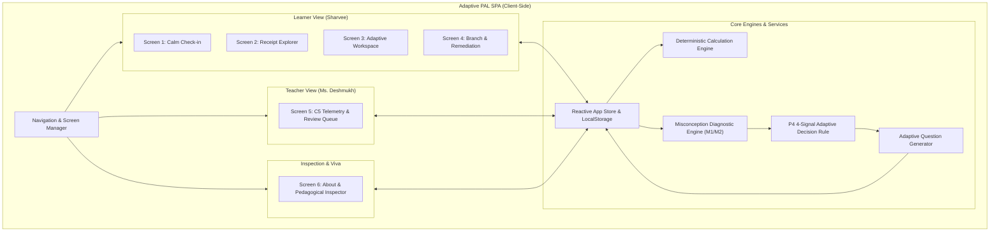
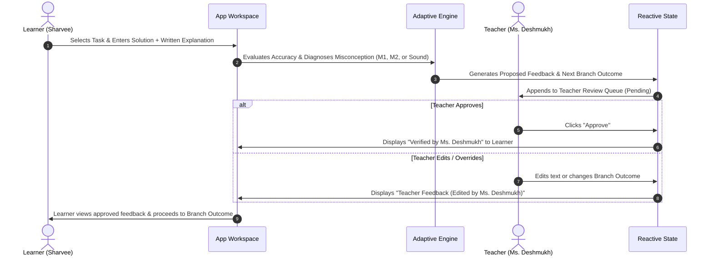
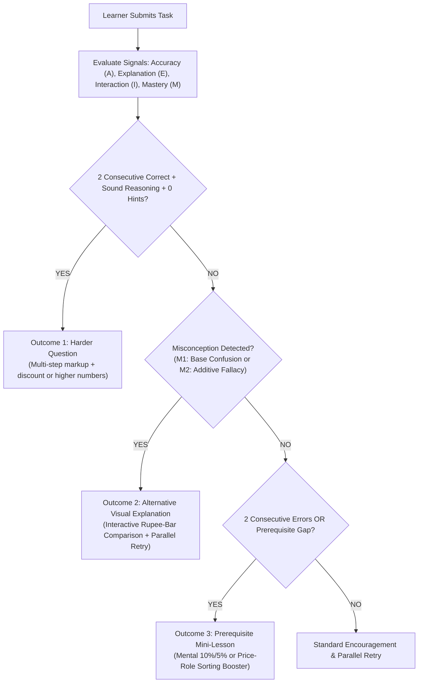

# Phase P1: System Architecture Specification

- **Identity Token:** `<24b3020>`
- **Exam Card:** `P4-T9-L5-C5`
- **Application:** Adaptive Percentage PAL with Teacher-in-the-Loop Supervision

---

## 1. Architectural Overview

The application is engineered as an ultra-reliable, zero-dependency, modular client-side Single-Page Application (SPA) designed to run in modern browsers on desktop or tablets. It maintains a reactive state store shared between two role views: **Learner View (Sharvee)** and **Teacher Dashboard (Ms. Deshmukh)**.

### Core Architectural Principles
1. **Zero-Failure Client-First Execution:** 100% of the mathematical validation, diagnostic rules, and state management run client-side without external server bottlenecks.
2. **Deterministic Mathematical Core:** All calculations (Selling Price, Discount %, Profit %) are verified deterministically by an exact mathematical engine, eliminating arithmetic hallucinations.
3. **C5 Dual-Role State Synchronization:** When the teacher approves, edits, or overrides AI feedback in the Teacher Dashboard, reactive state triggers real-time updates in the Learner View.
4. **Resilient AI Pipeline with Offline Fallback:** Written explanations are analyzed against pedagogical keyword heuristics and semantic misconception patterns, with an optional endpoint for live LLM inference if an API key is provided.

---

## 2. Mermaid Diagrams

### 2.1 System Component Diagram



### 2.2 User Interaction Flow



### 2.3 P4 Adaptive Decision Tree



---

## 3. Directory & Folder Structure

```
et617-endsem-24b3020/
├── AGENTS.md                  # Timed build-and-demo instructions
├── DESIGN.md                  # Official exam design specification
├── index.html                 # Main SPA HTML structure (all 6 screens)
├── styles.css                 # Responsive, accessible, calming UI styling
├── app.js                     # Application controller & state synchronization
├── src/
│   ├── state.js               # Reactive store, local storage persistence
│   ├── mathEngine.js          # Deterministic calculation engine
│   ├── diagnosticEngine.js    # Misconception diagnosis (M1, M2, Sound)
│   ├── adaptiveRules.js       # P4 decision rule (Outcomes 1, 2, 3)
│   ├── questionBank.js        # Question templates, generator & seeds
│   └── mockData.js            # Preloaded contrasting scenarios (A & B)
└── docs/
    ├── RENDER_DEPLOYMENT.md   # Deployment configuration guide
    ├── 00_PROBLEM_ANALYSIS.md # Phase P0 output
    ├── 01_DESIGN_RATIONALE.md # Phase P1 educational design
    ├── 02_ARCHITECTURE.md     # Phase P1 architecture & diagrams
    ├── 03_DESIGN_DECISIONS.md # Living Architecture Decision Records (ADRs)
    ├── 04_FEATURES.md         # MoSCoW feature mapping
    ├── 05_TESTING.md          # Verification and test results
    ├── 06_DEMO_SCRIPT.md      # 5-6 min viva demo walkthrough
    ├── 07_VIVA_QA.md          # 25+ evaluator Q&A pairs
    ├── 08_LIMITATIONS_AND_FUTURE_WORK.md
    └── 09_CODE_WALKTHROUGH.md # Codebase tour and module guide
```

---

## 4. Technology Stack & Justification

| Technology | Selection | Justification |
|---|---|---|
| **Markup & Layout** | HTML5 Semantic Elements | High accessibility, native screen-reader friendliness, zero build tool overhead. |
| **Styling** | Modern CSS3 (Variables, Flexbox, Grid) | Custom responsive layout ($360\text{px}$ to $1440\text{px}$), accessible contrast ($>4.5:1$), calming aesthetic for anxious learners. |
| **Client Scripting** | Vanilla ES6+ JavaScript | Maximum execution speed, zero bundler failures, immediate static deployment on Vercel/Render, trivial debugging during viva. |
| **Data Persistence** | Browser `localStorage` + Memory Store | Instant state synchronization between Learner and Teacher views without network latency or server configuration. |
| **Deterministic Math** | Custom Pure JS Math Engine | Eliminates LLM arithmetic hallucination completely. Guarantees 100% correct percentage bases. |
| **Hosting Platform** | Vercel / Render Static Site | Always-on, SSL-enabled, fast global CDN, continuous deployment from git `main`. |

---

## 5. Data Model Schema

### 5.1 `LearnerState`
```json
{
  "studentId": "L5_sharvee",
  "name": "Sharvee Kulkarni",
  "grade": 8,
  "confidenceScore": 2,
  "currentTaskIndex": 0,
  "mastery": {
    "LO1_DistinguishPrices": 0.4,
    "LO2_CalculateDiscountProfit": 0.3,
    "LO3_ExplainSuccessiveChanges": 0.2
  },
  "flags": {
    "M1_BaseValueConfusion": false,
    "M2_AdditiveFallacy": false
  },
  "history": []
}
```

### 5.2 `SubmissionRecord`
```json
{
  "submissionId": "sub_102",
  "taskId": "task_2",
  "taskTitle": "School Bag Monsoon Sale",
  "timestamp": "2026-11-18T19:20:00Z",
  "learnerInputs": {
    "sp": 850,
    "profitPct": 6.25,
    "explanation": "Discount is on MP 1000 and profit is on CP 800"
  },
  "deterministicCheck": {
    "isCorrect": true,
    "expectedSp": 850,
    "expectedProfitPct": 6.25
  },
  "diagnosticResult": {
    "classification": "Sound Reasoning",
    "misconceptionDetected": null
  },
  "proposedOutcome": "Outcome 1: Harder Question",
  "reviewStatus": "approved",
  "teacherFeedback": "Verified by Ms. Deshmukh: Spot on calculation and clear reasoning!",
  "reviewedBy": "Ms. Deshmukh"
}
```

---

## 6. Security, Privacy & Scalability

- **Security & Privacy:** No student PII or sensitive passwords collected; learner state is isolated to local browser sandbox; no unencrypted remote transmission.
- **Scalability (1 to 1,000 learners):** In a production school roll-out, the client-side reactive store connects to a lightweight WebSocket / Supabase backend where one teacher oversees multi-seat classrooms with sharded queues. The mathematical evaluation remains distributed on the edge/client, reducing server compute costs to near-zero.
